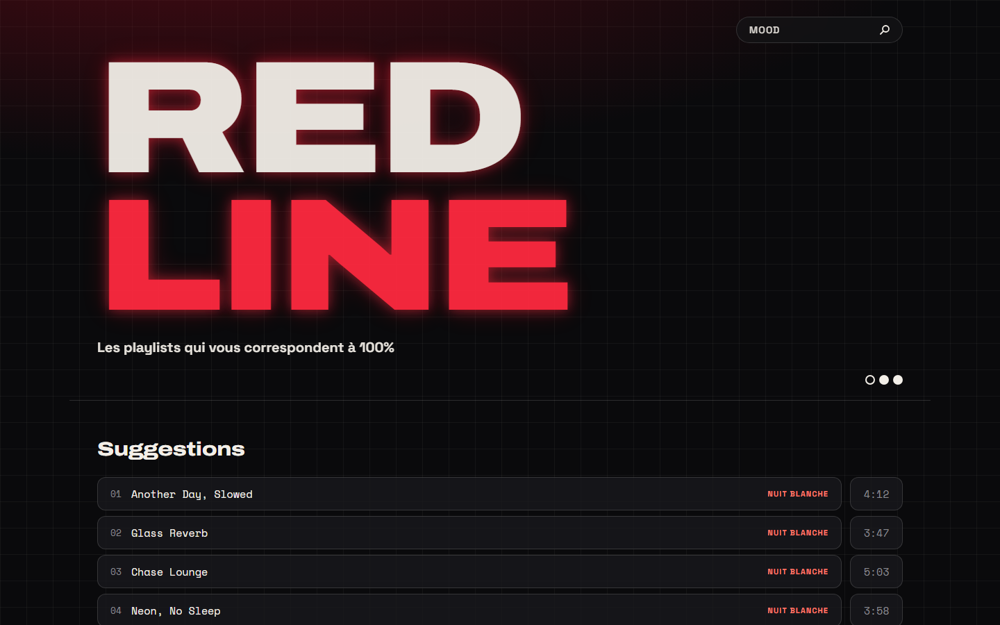
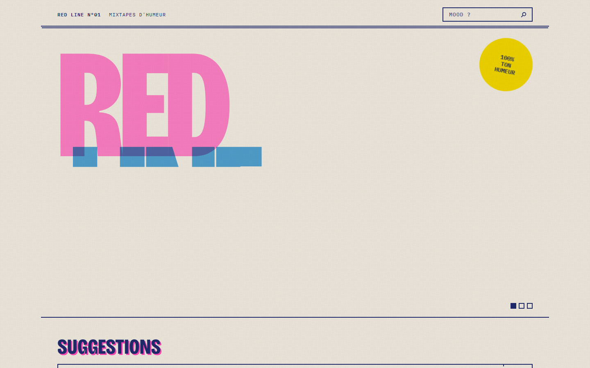
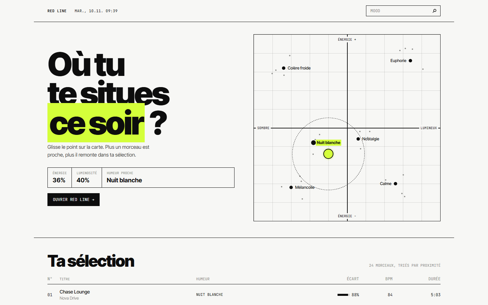
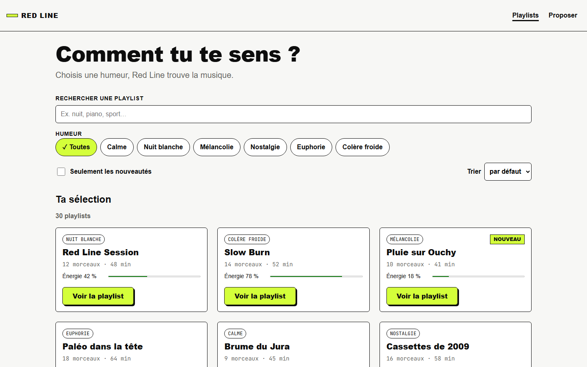

# Critique comparative & arbitrage — Red Line (e2-6)

Les 3 directions ont été générées avec l'IA à partir de [`brief.md`](../brief.md) et des wireframes, avec le contrat du cours (HTML sémantique, CSS à variables, zéro framework). Elles sont conservées dans `Redline-backups/` :

| Piste | Dossier | Personnalité |
| :--- | :--- | :--- |
| **V1 — Sombre néon** | `Redline-backups/v1_2026-09-29/` | Fond `#0a0a0c`, rouge `#ff2a40` avec halo lumineux, Archivo + Space Grotesk. Piste « moderne & pragmatique » version nuit. |
| **V2 — Riso zine** | `Redline-backups/v2_2026-09-29_riso-zine/` | Papier `#f0e9da`, encres riso (rose, bleu, jaune, vert, orange, violet), grain, Bricolage Grotesque + IBM Plex Mono. Piste « chaleureuse ». |
| **V3 — Mood map** | `Redline-backups/v3_2026-09-29_mood-map/` (= `redline/` actuel) | Papier `#f7f7f5`, encre `#0d0d0d`, une seule couleur acide `#d4ff3a`, traits fins, Inter Tight + JetBrains Mono. Piste « éditoriale & sobre ». |

| Capture | V1 | V2 | V3 |
| :--- | :---: | :---: | :---: |
| Desktop 1440 px |  |  |  |

Résultat intégré (app finale) : 

## Matrice d'évaluation (1 = cassé · 5 = très bien)
| Critère | V1 Sombre néon | V2 Riso zine | V3 Mood map |
| :--- | :-: | :-: | :-: |
| Lisibilité | 4 | 2 | 5 |
| Navigation | 4 | 3 | 4 |
| Feedback | 4 | 3 | 4 |
| Cohérence | 4 | 2 | 5 |
| Accessibilité | 3 | 2 | 4 |
| **Total /25** | **19** | **12** | **22** |

## Fiches critiques

### V1 — Sombre néon
- **Force 1 — Lisibilité** : crème `#f3efe8` sur `#0a0a0c` ≈ 17:1.
- **Force 2 — Cohérence avec le pitch** : ambiance « nuit, trajet » très forte.
- **Faiblesse 1 — Accessibilité** : le halo rouge (`--glow`) et le texte gris `#8a8a90` fatiguent sur longue lecture ; rouge = seule couleur d'action *et* d'alerte.
- **Faiblesse 2 — Contexte d'usage** : dans un train en plein jour, un écran très sombre reflète et se lit mal (persona Noah, matin).
- **Verdict :** éliminé de justesse — parfait le soir, moins bon le matin dans le train.

### V2 — Riso zine
- **Force 1 — Identité** : la plus originale, mémorable.
- **Force 2 — Chaleur** : grain papier agréable.
- **Faiblesse 1 — Accessibilité** : rose `#ff48b0` sur papier ≈ 2.6:1, jaune `#ffe800` illisible en texte → échec AA.
- **Faiblesse 2 — Cohérence** : 6 couleurs d'encre sans rôle fixe (loi de similarité cassée : on ne sait plus ce qui est cliquable), grain = bruit visuel, police mono pour tout le texte = lecture lente.
- **Verdict :** éliminé — joli en affiche, mais Noah doit trouver une playlist en 30 s.

### V3 — Mood map
- **Force 1 — Lisibilité** : encre sur papier ≈ 18:1, hiérarchie typographique nette, la carte des humeurs est l'élément central (tâche n°1 du flow).
- **Force 2 — Cohérence** : 1 seule couleur d'accent avec 1 seul rôle (« tu es ici / actif »).
- **Faiblesse 1 — Accessibilité** : le gris secondaire `#8c8c88` ≈ 3.2:1 → **à foncer** en `#5f5f5b` (≈ 6:1). L'acide `#d4ff3a` ne doit jamais servir de couleur de texte (1.1:1).
- **Faiblesse 2 — Feedback** : survol des cartes trop discret → ajouter l'ombre portée décalée prévue dans `wireframes/etats-transitions.md`.
- **Verdict :** **retenu**.

## Arbitrage
Nous retenons la **piste V3 « Mood map »** parce qu'elle obtient le meilleur total (22/25) et surtout les meilleures notes sur les deux critères qui comptent pour Noah dans le train : lisibilité (contraste ≈ 18:1 en plein jour) et cohérence (une seule couleur d'accent = un seul sens). Nous lui intégrons le **mode sombre de la piste V1** comme thème du soir (`prefers-color-scheme: dark`), ce qui garde l'ambiance nocturne du pitch sans la subir le matin. Corrections obligatoires avant intégration : gris secondaire foncé à `#5f5f5b`, acide réservé aux fonds, focus visible 3 px.
