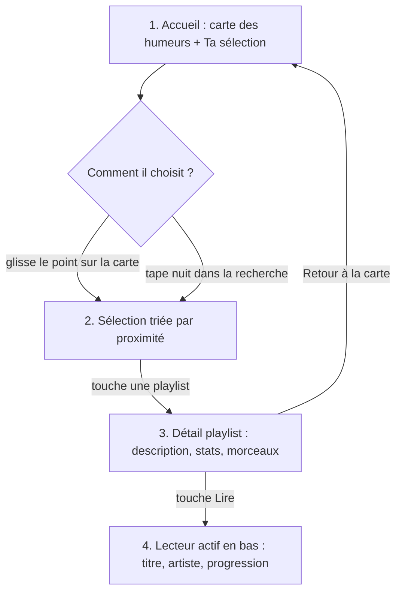

# User flow — tâche principale

**Tâche :** trouver une playlist adaptée à son humeur et lancer la lecture.
**Début :** Noah ouvre Red Line sur son téléphone dans le train.
**Fin réussie :** Noah a lancé une playlist et le lecteur en bas d'écran indique le morceau en cours.

## Chemin
1. **Accueil / Entrée** — Noah voit la carte des humeurs (axes Énergie et Luminosité) et la liste « Ta sélection ».
2. **Filtrage / Recherche** — il glisse le point vers « calme / sombre » *ou* tape « nuit » dans la barre de recherche. La liste se réordonne immédiatement.
3. **Consultation détaillée** — il ouvre « Red Line Session » : description, ambiance, liste des morceaux avec BPM et durée.
4. **Action / Clôture** — il touche **▶ Lire** : le lecteur apparaît en bas avec le titre du morceau ; confirmation visuelle immédiate (le bouton devient ⏸).

## Variante d'échec
Si la recherche ne trouve rien, l'écran dit : *« Aucune humeur ne correspond. Essaie « calme », « colère » ou « nuit ». »* avec les 3 mots cliquables.
