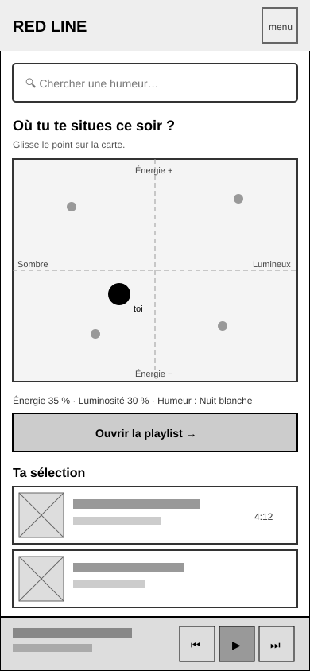
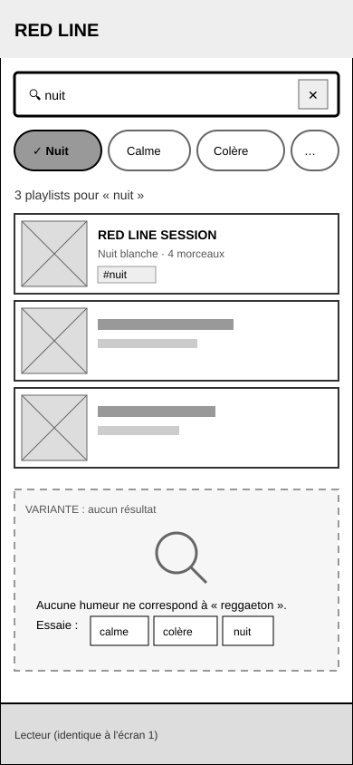
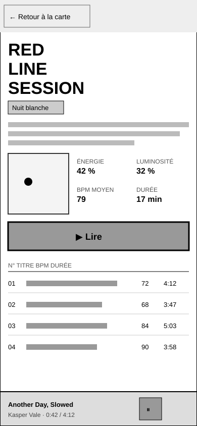

# Wireframes Red Line

Basse fidélité, niveaux de gris uniquement, mobile 390 px d'abord.

| Écran | Fichier |
| :--- | :--- |
| 1 — Accueil & exploration |  |
| 2 — Vue filtrée / recherche (+ état vide) |  |
| 3 — Fiche détaillée |  |
| Desktop 1440 px, grille 12 col (3 + 9) | [desktop-1440.svg](desktop-1440.svg) |

États et transitions : [etats-transitions.md](etats-transitions.md).

> Format SVG (vectoriel, s'affiche directement sur GitHub) au lieu du PNG demandé : même rendu, plus net. Si le prof exige du PNG : ouvrir le SVG dans le navigateur → capture.
